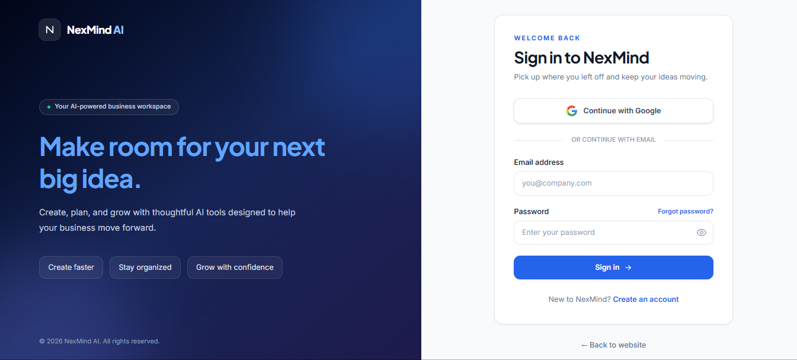
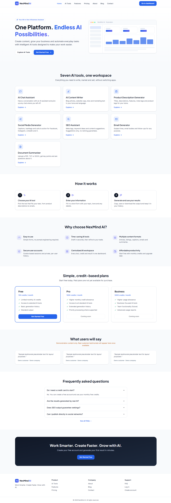
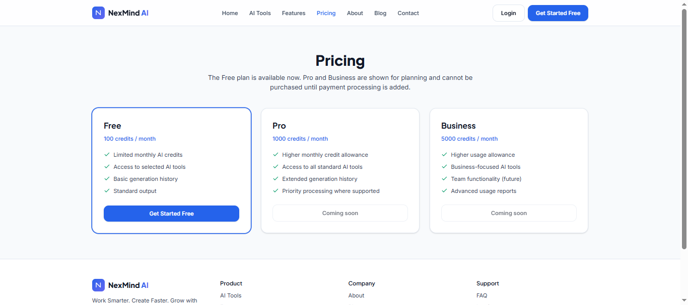
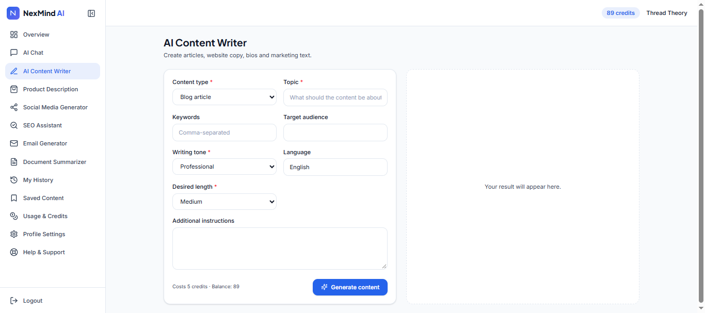
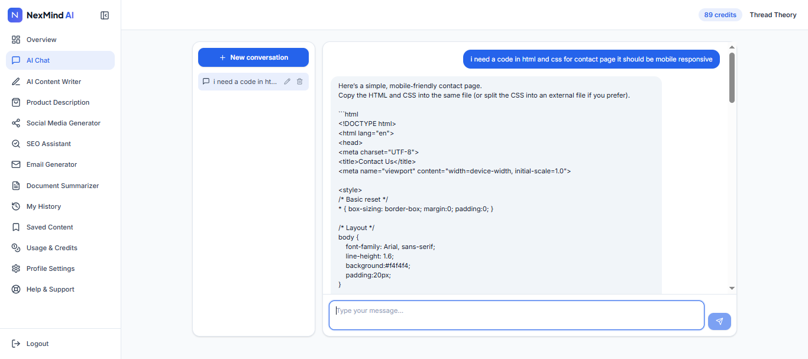
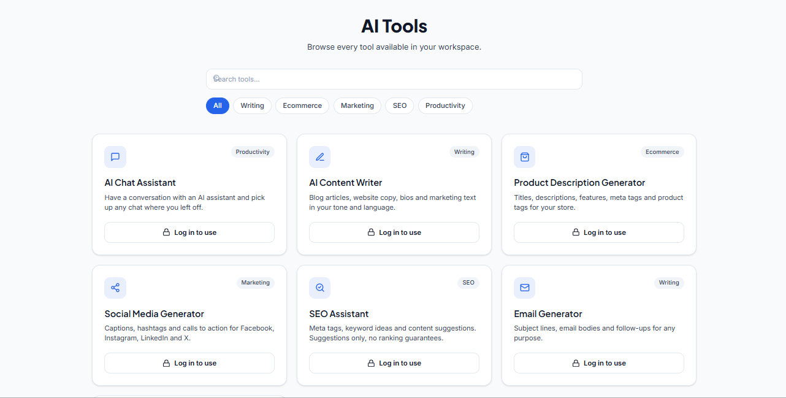
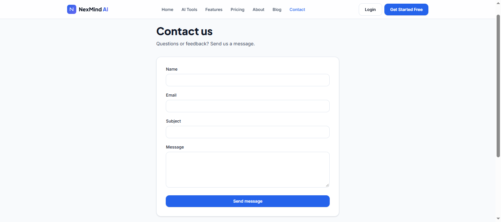
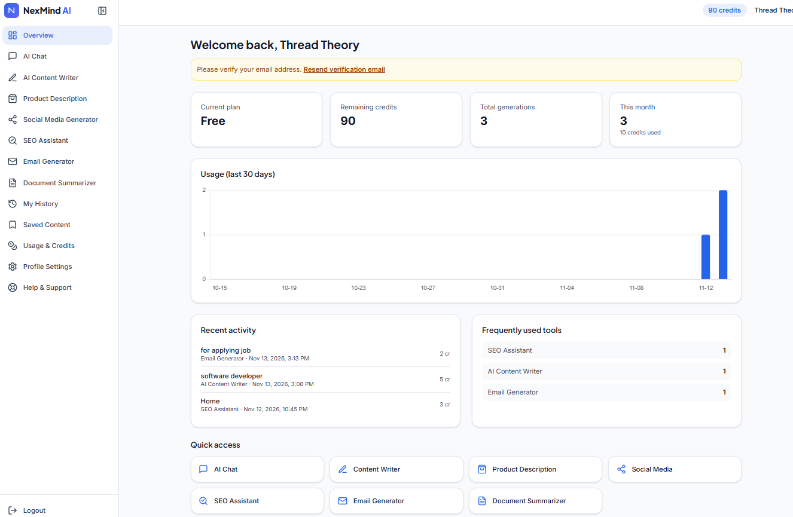
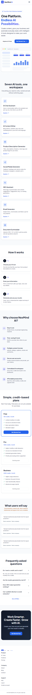

# NexMind AI

**Your All-in-One AI Business Assistant** — *Work Smarter. Create Faster. Grow with AI.*

A Laravel 12 REST API + Vue 3 SPA with real OpenAI-backed tools, a credit system, a user dashboard and an admin panel.

## Screenshots

<p align="center">
  
</p>

<p align="center">
  
  
</p>

<p align="center">
  
  
</p>

<p align="center">
  
  
</p>

<p align="center">
  
  
</p>

<p align="center">
  
</p>

## Features

- **7 AI tools:** Chat, Content Writer, Product Description, Social Media, SEO, Email, Document Summarizer (PDF / TXT / DOCX)
- **Credits:** per-plan monthly allowance (Free = 100, admin-editable), per-tool cost, transactional locking, no charge on failure, full ledger
- **Public site:** Home, Features, AI Tools, Pricing, About, Contact, Blog, FAQ
- **Auth:** register, email/password and Google sign-in, logout, email verification, password reset (Sanctum SPA cookies)
- **Dashboard:** overview + usage chart, history, saved content, credits, settings
- **Admin panel:** users, roles, tools, AI settings, plans, credits, generations, usage, blogs, categories, FAQs, contact messages, settings
- **Security:** Form Requests, Policies, role middleware, rate limiting, prompt-injection guard with delimited untrusted input, API key backend-only, no tokens in localStorage, text-only output rendering (no `v-html`), private document storage with immediate raw-file deletion

## Project layout (single Laravel project)

```
app/ bootstrap/ config/ database/ routes/ tests/   Laravel API (PHP)
resources/js/                                      Vue 3 app (Pinia, Router, Tailwind v4)
resources/views/app.blade.php                      HTML shell that loads the Vue app
public/build/                                      Prebuilt frontend (rebuild with npm run build)
docs/                                              Schema, API docs, Postman, plan, checklist
```

## Quick start (Windows / Laragon)

See [INSTALL.md](INSTALL.md). Short version:

```powershell
composer install
copy .env.example .env      # then edit DB_* and OPENAI_API_KEY
php artisan key:generate
php artisan migrate --seed
php artisan serve
# optional, only while editing Vue files:  npm install && npm run dev
```
Open http://localhost:8000. Google sign-in is optional; configure `GOOGLE_CLIENT_ID`, `GOOGLE_CLIENT_SECRET`, and `GOOGLE_REDIRECT_URI` in `.env` to enable it (see [INSTALL.md](INSTALL.md)).

## Verification status (honest)

| Area | Status |
|---|---|
| Frontend build (`vite build`) | Executed, passes |
| Frontend unit tests (vitest, 34 tests) | Executed, pass |
| Frontend browser smoke test | Executed against mocked API responses only |
| Backend PHP syntax (`php -l`, all files) | Executed, clean |
| API docs / Postman vs `routes/api.php` | Generated and cross-checked by script (92 endpoints) |
| Backend PHPUnit tests | Written, **never executed** (sandbox had no Packagist/MySQL) |
| Backend runtime behaviour, migrations, seeders | **Not executed** |
| Live OpenAI calls, email sending | **Not tested** (needs your credentials) |
| Payments / subscriptions | **Not implemented** (schema only) |
| Social auto-publishing | **Not implemented** (text generation only) |

Run `php artisan test` first and expect to fix some issues; the suite covers auth, credits, tools, ownership, admin access, documents and public API.

## Documentation

- [Installation & deployment](INSTALL.md)
- [Database schema](docs/DATABASE_SCHEMA.md)
- [API documentation](docs/API_DOCUMENTATION.md) and [Postman collection](docs/NexMind-AI.postman_collection.json)
- [Plan](docs/PLAN.md) · [Checklist](docs/CHECKLIST.md)
